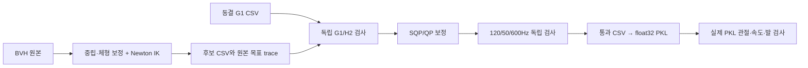

# BVH → H2 CSV → SQP/QP → PKL

2026-11-04 기준 H100에서 사용한 경로를 `h2_pipeline/`에 보존했다. `production/`에는 Newton IK, 중립 보정, 동결 G1 비교, 상체 SQP, 발 재구성, 독립 검증과 PIQP/OSQP 폴백 구현이 있다. 최상위 SOMA 변환기의 기본 설정과 이 보정 recipe는 구분한다.

최적화 대상은 로봇 root/관절의 시간 궤적이며 결과도 CSV다. PKL 단계는 단위·관절 순서·쿼터니언을 학습 형식으로 포장하고 실제 float32 결과를 재검사한다. 기존 PKL에서 BVH를 역생성하지 않는다.



## 환경과 입력

Python3.12 이상과 저장소의 Newton/Warp 환경을 사용한다. CPU 검사/보정에는 `pip install -e '.[h2,test]'`의 MuJoCo·SciPy·OSQP·joblib·PyTorch도 필요하다. 기존 환경에 영향을 주지 않도록 별도 환경을 사용한다. 원본 BVH, 같은 모션의 기존 G1 CSV, H2/G1 메시를 준비한다. 로봇 자산은 [GR00T-WholeBodyControl/h2-transfer-dev](https://github.com/MFIWO/GR00T-WholeBodyControl/tree/h2-transfer-dev)의 `gear_sonic/data/assets/robot_description/`에서 읽는다. Git LFS 포인터만 있으면 준비가 실패한다.

selection은 `{"motions":[{"key":"BVH_파일명_확장자제외"}]}` 형식이다. 중복 basename과 빠진 G1 CSV는 허용하지 않는다. 기존 G1 CSV는 cm/degree, 비교용 내부 사본은 m/radian이다. 이 recipe의 원본 시간 기준은120Hz다.

```bash
python -m h2_pipeline prepare \
  --workspace /absolute/path/to/NEW_h2_workspace \
  --groot-root /absolute/path/to/GR00T-WholeBodyControl \
  --selection /absolute/path/to/selection.json \
  --bvh-root /absolute/path/to/original_bvh \
  --g1-csv-root /absolute/path/to/existing_g1_csv --limit 2
```

처음에는 `--limit 2`로 확인한다. 전체 변환은 새로운 작업 폴더에서 제한 없이 준비한다. 원본을 변경하지 않고 코드·모델 정의·중립 보정 수치를 복사하며 큰 메시만 읽기 연결한다. 연결 메시까지 해시로 봉인한다. 복사된 코드의 H100 절대 경로와 Python 경로만 치환하고 목적 함수·통과 기준은 유지한다. `workspace.json`에 치환 전후 해시를 남긴다.

## BVH를 CSV로 재구성

```bash
python -m h2_pipeline retarget \
  --workspace /absolute/path/to/NEW_h2_workspace --workers 4
```

이 단계는 GPU0/1을 사용한다. Newton/Warp용 Python이 따로 있으면 `--soma-python /path/to/soma-env/bin/python`을 지정한다. 초기 IK, CUDA 궤적 보정, CPU 독립 비교 검사 순서다. `--stop-after raw` 또는 `refine`으로 단계 경계를 나눌 수 있다. G1 IK는 다시 실행하지 않는다.

중립은 source heading을 보존한 기준 자세, 몸통 roll/pitch, 대칭의 약한 무릎 굽힘, 평행한 발과 원본 팔 방향을 이용한 보정이다. 실제 숙임·회전을 항상 허리0으로 만들지는 않는다. 팔은 사람의 어깨→팔꿈치→손 방향과 로봇 분절 길이로 재구성하며 손목 방향도 검사한다. 몸통 좌우 추종 오차 검사는 양발 하중50:50의 동역학 검사와 다르다.

## 보류 CSV의 SQP/QP

```bash
python -m h2_pipeline plan --workspace /absolute/path/to/NEW_h2_workspace
python -m h2_pipeline optimize \
  --workspace /absolute/path/to/NEW_h2_workspace --workers 4 --dry-run
python -m h2_pipeline optimize \
  --workspace /absolute/path/to/NEW_h2_workspace --workers 4 --backend osqp
```

기본 CPU OSQP 경로는 관절 범위·URDF 속도·어깨/손목2도 여유, 원본 시간축과 root 회전, 발 지면 제약을 유지한다. 필요하면 root 이동/다리를 먼저 보정하고 이후 발·root를 보존하면서 상체를 푼다. BVH에서 만든 상체 목표를 먼저 동결하고, 완료된 목표 자체로 초기화하지 않는 별도 재최적화로 추종을 확인한다. 원본 BVH 대비 주요 오차 비악화와 독립 발 검사까지 통과해야 `validated/`에 남는다.

빠른 PIQP 경로를 사용하려면 `piqp==0.6.4`를 작업 폴더의 `artifacts/h2_foot_trajectory_v10/vendor_piqp/`에 설치하고 `--backend piqp`를 사용한다. 이 경로는 공유 CUDA 기하 계산을 사용한다. PIQP 해를 원래 QP 행렬·잔차 허용값으로 검사하고 실패하면 원래 CPU OSQP로 돌아간다. 몸통 범주는 기존 전체 OSQP 경로를 유지하며 최종 기준 미달이면 기존 전체 경로로 한 번 재시도한다. 병렬 기본값은4이고 과거192개 실행을 자동으로 재현하지 않는다.

## 통과 CSV만 PKL로 인계

```bash
python -m h2_pipeline publish \
  --workspace /absolute/path/to/NEW_h2_workspace \
  --out /absolute/path/to/NEW_h2_pkl \
  --smpl-root /absolute/path/to/paired_smpl \
  --soma-root /absolute/path/to/paired_soma
```

출력도 새 폴더여야 한다. SMPL/SOMA 인자는 선택적 대응 파일 해시 기록용이다. 조인트를 임의 합성하지 않으며 실제 학습에는 대응 데이터·시간 정렬·학습 manifest 검증도 필요하다.

- 원본 또는 새 H2 통과 보고서와 CSV 해시, 원본 BVH/G1/trace 해시를 확인한다.
- 내부 CSV는 **m/radian**, 원본120Hz/frame ID를 보존한다. 공식 CSV의 **cm/degree**와 섞어 추측하지 않는다.
- PKL은 MJCF 관절 이름 순서, root quaternion **XYZW**, float32 `dof/root_trans_offset/root_rot/pose_aa`, `fps` 계약을 따른다.
- 실제 float32 출력으로 관절·속도·여유와120/50/600Hz의 원본 BVH 기반 발 높이·침투·접지 목표를 재계산한다. 포장할 때 root를 추가로 올리지 않는다.
- 통과만 `motion/`·`catalog.json`에 들어간다. 보류 사유는 `requires_review.json`에 남기고 학습 풀을 자동 수정하지 않는다.

이번 게시 검증에서는 현재 H100 학습을 보호하기 위해 새 BVH GPU 전량 변환을 실행하지 않았다. 단위·이름 매핑·프레임·해시 시험, 실제 자산을 이용한 격리 준비, 기존 결과의 CPU 재검사를 구분해 기록한다. 운동학 통과를 정책 추종·자기충돌 전체·실기 안정성 보증으로 사용하지 않는다.
